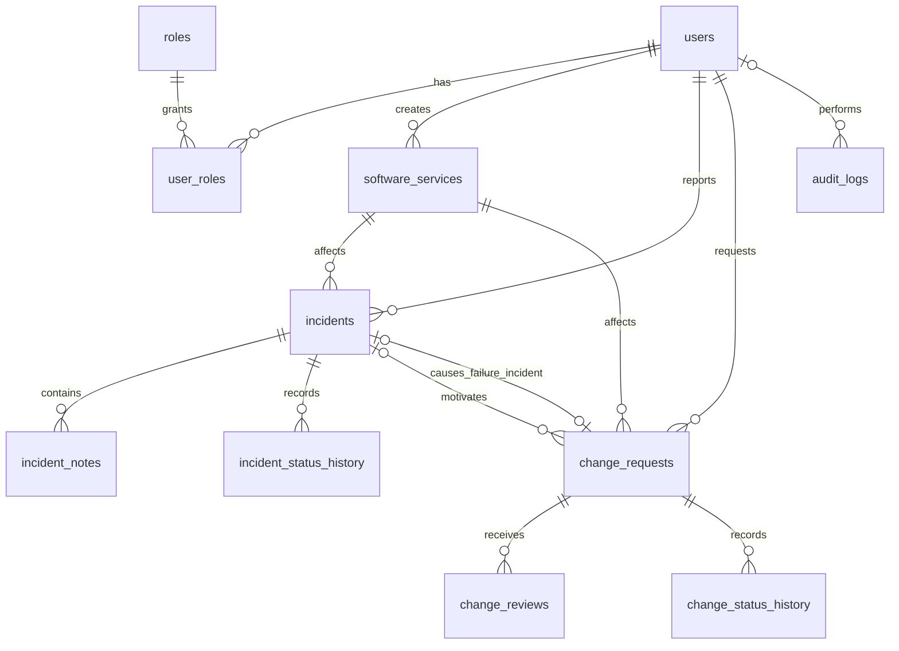

# OpsFlow 数据库设计

数据库为本机 PostgreSQL 的 `opsflow`，业务表位于 `public` schema。初始结构包含 11 张业务表，另由 Flyway 创建一张迁移记录表 `flyway_schema_history`。

## 模块与表

| 模块 | 表 | 用途 |
| --- | --- | --- |
| 用户权限 | `users` | 用户资料、密码哈希、账号启停 |
| 用户权限 | `roles` | 三种应用角色 |
| 用户权限 | `user_roles` | 用户与角色的多对多关系 |
| 服务管理 | `software_services` | 软件服务、负责人、启停 |
| 事件管理 | `incidents` | 事件、分配、严重程度、状态与解决结果 |
| 事件管理 | `incident_notes` | 调查备注 |
| 事件管理 | `incident_status_history` | 事件状态变化历史 |
| 变更管理 | `change_requests` | 变更草稿、风险、计划、状态与实施结果 |
| 变更审批 | `change_reviews` | 每一轮提交的审批决定和意见 |
| 变更管理 | `change_status_history` | 变更状态变化历史 |
| 审计 | `audit_logs` | 用户操作、对象与结构化明细 |

统计仪表盘查询现有业务数据，不单独存一份统计结果。

## 表关系



关系图展示主要关系；其他操作人、负责人外键以 SQL 为准。

## 通用约定

- 主键使用 `BIGINT` 自增标识；`user_roles` 使用双列联合主键。
- 时间使用 `TIMESTAMPTZ`，保留绝对时间，由接口统一输出时区。
- 状态使用受 CHECK 约束的字符串，方便后续 Java 枚举映射。
- `users`、`software_services`、`incidents`、`change_requests` 含 `version`，后续实体使用 `@Version` 实现并发控制。
- 上述四张表的 `updated_at` 由数据库触发器自动维护。
- 用户与服务通过 `enabled` 停用。外键默认阻止删除仍被引用的记录，不级联清空历史。
- `password_hash` 只保存密码编码结果。应用日志和审计内容不保存原始密码、密码哈希或访问令牌。
- 用户名、邮箱、服务编码均有忽略大小写的唯一索引。邮箱格式和密码策略由接口校验。

## 字段说明

### users

`id`、`username`、`email`、`display_name`、`password_hash`、`enabled`、`last_login_at`、`created_at`、`updated_at`、`version`。

用户名最长 50、邮箱 254、显示名 100、密码编码结果 255 个字符。用户名和邮箱必须唯一且不包含首尾空格。

### roles 与 user_roles

`roles`：`id`、`code`、`name`、`description`。

`user_roles`：`user_id`、`role_id`、`assigned_at`、`assigned_by`。同一角色不能重复授予同一用户；`assigned_by` 可为空以容纳首次初始化。

初始化的角色为 `ADMINISTRATOR`、`DEVELOPER`、`APPROVER`。这些是应用角色，不是 PostgreSQL 登录账号。没有预置用户或默认密码。

### software_services

`id`、`code`、`name`、`description`、`owner_id`、`enabled`、`created_by`、`created_at`、`updated_at`、`version`。

服务编码唯一；负责人可稍后分配，创建人必须存在。

### incidents

`id`、`service_id`、`reporter_id`、`assignee_id`、`title`、`description`、`severity`、`status`、`resolution`、`source_change_id`、`resolved_at`、`closed_at`、`created_at`、`updated_at`、`version`。

| 字段 | 可选值或规则 |
| --- | --- |
| `severity` | `LOW`、`MEDIUM`、`HIGH`、`CRITICAL` |
| `status` | `OPEN`、`ASSIGNED`、`INVESTIGATING`、`RESOLVED`、`CLOSED` |
| `assignee_id` | OPEN 时为空；其他状态必须有被分配人 |
| `resolution` | RESOLVED/CLOSED 时必填 |
| `resolved_at` | 仅 RESOLVED/CLOSED 时存在 |
| `closed_at` | 仅 CLOSED 时存在，且不早于解决时间 |
| `source_change_id` | 产生该事件的失败变更，可为空，同一变更最多对应一个新事件 |

### incident_notes 与 incident_status_history

`incident_notes`：`id`、`incident_id`、`author_id`、`content`、`created_at`。

`incident_status_history`：`id`、`incident_id`、`old_status`、`new_status`、`changed_by`、`comment`、`changed_at`。

首次创建记录的 `old_status` 可以为空；后续新旧状态不能相同。备注和历史按时间、主键排序，接口层按追加方式写入。

### change_requests

`id`、`service_id`、`requester_id`、`related_incident_id`、`title`、`business_reason`、`risk_level`、`planned_implementation_at`、`implementation_plan`、`rollback_plan`、`status`、`submission_number`、`submitted_at`、`implementation_started_at`、`implementation_finished_at`、`implementation_result`、`created_at`、`updated_at`、`version`。

| 字段 | 可选值或规则 |
| --- | --- |
| `risk_level` | `LOW`、`MEDIUM`、`HIGH`；草稿允许未填写 |
| `status` | `DRAFT`、`PENDING_APPROVAL`、`APPROVED`、`REJECTED`、`IMPLEMENTING`、`COMPLETED`、`FAILED` |
| `submission_number` | 初始为 0；每次提交递增，用于保留历次审批 |
| 非草稿 | 必须有提交轮次、提交时间、原因、风险、计划时间、实施计划和回滚计划 |
| 实施中或结束 | 必须有实施开始时间 |
| COMPLETED/FAILED | 必须有实施结束时间和结果说明 |
| `related_incident_id` | 可选，表示本变更要处理的已有事件 |

`related_incident_id` 是变更提出前的相关事件；`incidents.source_change_id` 是变更失败后产生的新事件。两个方向分别保存，均通过复合外键保证服务一致。

### change_reviews 与 change_status_history

`change_reviews`：`id`、`change_request_id`、`submission_number`、`reviewer_id`、`decision`、`comment`、`reviewed_at`。

每一轮提交只允许一条最终审批决定。`decision` 只能是 `APPROVED` 或 `REJECTED`，拒绝时必须填写意见。本期设计为单人审批；审批人的资格、提交轮次匹配及重提流程由后端业务校验。

`change_status_history`：`id`、`change_request_id`、`old_status`、`new_status`、`changed_by`、`comment`、`changed_at`。规则与事件历史相同。

### audit_logs

`id`、`actor_id`、`action`、`entity_type`、`entity_id`、`details`、`request_id`、`client_ip`、`occurred_at`。

- `actor_id` 可为空，表示系统动作。
- `entity_type` 为 `USER`、`ROLE`、`SERVICE`、`INCIDENT` 或 `CHANGE_REQUEST`。
- `entity_id` 是对应业务记录的主键，由后端校验存在性；此多类型引用不使用外键。
- `details` 是 JSONB 对象，默认 `{}`；`request_id` 是可选 UUID，`client_ip` 是可选 INET 地址。

## 数据库与接口的职责

数据库保证主外键、必填字段、允许的枚举值、基本状态字段一致性、时间顺序和唯一性。

有效的状态跳转顺序、当前用户权限、审批资格、审批轮次、只能从 FAILED 变更创建关联事件等规则，由后续后端服务和 State 等设计实现。历史与审计不会自动产生，后端必须在同一业务事务中写入。

## 迁移和检查

初次启动 local profile 后，Flyway 按顺序执行：

1. `V1__create_opsflow_schema.sql`：创建表、约束、索引和时间触发器。
2. `V2__seed_application_roles.sql`：写入三种角色。

后续重启会校验迁移记录，不重复建表。新增结构调整应新增 `V3__...sql`，不要修改已经执行的 V1/V2。已关闭 Flyway clean，也未启用自动 baseline。

可在 pgAdmin 的 `opsflow` 数据库中运行：

```sql
SELECT table_name
FROM information_schema.tables
WHERE table_schema = 'public' AND table_type = 'BASE TABLE'
ORDER BY table_name;

SELECT version, description, success FROM public.flyway_schema_history ORDER BY installed_rank;
SELECT code, name FROM public.roles ORDER BY id;
```

请通过 Flyway 执行版本化迁移，不要在 pgAdmin 重复执行已应用的脚本。

## 实际 PostgreSQL 测试

常规 H2 接口测试不会执行 PostgreSQL 专用迁移。显式运行本地数据库测试会应用待执行迁移，并验证真实约束：

```powershell
$env:OPSFLOW_POSTGRES_TESTS = 'true'
.\mvnw.cmd test '-Dtest=DatabaseSchemaPostgresTests'
Remove-Item Env:OPSFLOW_POSTGRES_TESTS
```

需要已配置的 `application-local.yml`。每个测试的数据自动回滚；迁移和初始化角色保留。自增序列可能产生跳号，这是正常情况。
